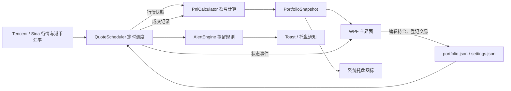

# KanPan 看盘

常驻 Windows 系统托盘的看盘工具，支持 A 股、场内 ETF 和港股，展示持仓市值与当日盈亏。持仓和交易记录保存在本机。

## 下载运行

**[下载 Windows x64 版 KanPan-2.0.1.exe](https://github.com/wang-ironman/KanPan/raw/refs/heads/main/publish/KanPan-2.0.1.exe)**

也可以打开仓库的 [publish 目录](publish)，选择 exe 文件后点击下载。

- 支持 Windows 10 / 11，64 位系统。
- 下载后直接运行，无需安装 .NET 运行时。
- 升级时先退出旧版，再运行新版；本地持仓和设置继续保留。

## 开始使用

1. 运行程序，点击“编辑持仓…”，每行填写证券代码、股数、可选成本价：

   ```text
   600519,100,1550
   510300,10000
   00700,200,380
   ```

2. 点击“解析预览”，核对后保存。A 股和 ETF 使用 6 位代码，港股使用 5 位代码；港股成本价按港元填写。
3. 当天买卖通过“记一笔交易…”登记成交价、数量及手续费，程序自动更新持仓并计算当日盈亏。
4. 关闭主窗口后程序继续在托盘运行；单击托盘图标显示或隐藏窗口，右键菜单可退出。

完整说明见 [使用说明](docs/使用说明.md)。

## 功能

- 批量粘贴或导入 CSV / TXT 持仓。
- 展示持仓市值、当日盈亏，以及填写成本价后的持仓累计盈亏。
- 记录买入、卖出和手续费；当天清仓收益仍保留，重启后恢复。
- 港股金额按港币兑人民币汇率折算汇总。
- 托盘显示盈亏比例，支持涨跌提醒、工作模式、开机启动和收盘后自动退出。

## 盈亏口径

当日盈亏根据行情和本地登记的交易计算：

```text
期初股数 = 当前股数 - 当日买入股数 + 当日卖出股数
当日盈亏 = 当前市值 - 期初持仓昨收市值 + 当日卖出金额 - 当日买入金额 - 当日手续费
当日盈亏比例 = 当日盈亏 / 期初持仓昨收市值 × 100%
```

当前比例的分母不含账户现金和融资负债，期初没有持仓时显示 0%，因此可能与券商融资账户的整体收益率不同。程序未接入券商账户，未登记的成交、费用、分红和融资利息不会自动同步；旧版未保存的交易无法自动补算。

## 技术架构

| 部分 | 技术与职责 |
| --- | --- |
| 桌面应用 | .NET 10、C#、WPF 主窗口；CommunityToolkit.Mvvm 8.4.2；WinForms `NotifyIcon` 与 `System.Drawing` 托盘图标；Microsoft.Toolkit.Uwp.Notifications 7.1.3 提供 Toast |
| Core | `net10.0`，无第三方依赖；证券和交易模型、日历、盈亏与交易计算、行情调度、提醒规则 |
| Infrastructure | `net10.0`，依赖 Core；腾讯／新浪行情和汇率 HTTP 适配器、JSON 文件存储、日志 |
| Tests | xUnit 2.9.3、Microsoft.NET.Test.Sdk 17.14.1；覆盖规则、计算、解析、调度、存储和故障切换等离线测试 |
| 发布 | Windows x64 self-contained 单文件发布，包含 .NET 运行时 |

依赖方向为 App → Core 与 Infrastructure，Infrastructure → Core。Core 不依赖桌面 UI 或网络实现。



### 行情、交易与日期

- App 启动时由 `QuoteScheduler` 获取持仓和最新交易涉及的证券。腾讯行情为主源，连续失败 3 次后切换新浪；使用新浪期间每 5 分钟探测腾讯是否恢复。行情按各市场交易阶段调度：开市阶段使用设置的刷新间隔（3–60 秒），午休和闭市复查间隔为 60 秒，失败后按 5、10、30、60 秒退避。
- 港股以港元报价，汇率适配器依次尝试腾讯和新浪。汇率启动时获取，港股开市时每 10 分钟刷新；失败则保留上次值并 1 分钟后重试。上次成功汇率也会保存在设置文件中供离线启动使用。
- `PnlCalculator` 按北京时间及行情交易日期计算账户内持仓和当日登记交易的当日盈亏。所用当日盈亏比例分母是期初持仓昨收市值，不包括现金和融资负债；港股汇率变动不计入当日盈亏。未登记成交及券商账户现金、融资、费用和分红不会自动同步，因此应用结果不保证与券商账户整体盈亏一致。
- 持仓、成本价和交易保存在 `%APPDATA%\KanPan\portfolio.json`；偏好和上次港币汇率保存在 `settings.json`。登记交易时更新持仓并记录北京时间当天的成交；清仓头寸的当日成交仍会参与已实现盈亏计算。跨日后历史成交不再作为当天盈亏输入。文件通过临时文件写入后替换，损坏的 JSON 会备份为 `.bak` 并加载默认数据。
- 行情调度循环运行于后台任务，发布快照和提醒事件；WPF App 将界面及托盘更新派发到 UI Dispatcher。提醒状态由调度线程保存。收盘后自动退出由 WPF `DispatcherTimer` 每 30 秒检查；托盘提醒动画使用 UI 定时器。

更多实现背景见[技术设计](docs/TECH_DESIGN.md)。技术设计文档包含方案演进记录，实际实现以当前源码为准。

## 本地数据

持仓、交易记录、设置和日志位于 `%APPDATA%\KanPan`。更换电脑时可备份并复制该文件夹。

## 从源码构建

开发环境：Windows、.NET 10 SDK。

```powershell
dotnet build src/KanPan.App/KanPan.App.csproj
dotnet test tests/KanPan.Tests/KanPan.Tests.csproj
```

生成包含 .NET 运行时的 Windows x64 单文件程序：

```powershell
dotnet publish src/KanPan.App/KanPan.App.csproj -c Release -r win-x64 --self-contained true -p:PublishSingleFile=true -p:IncludeNativeLibrariesForSelfExtract=true -p:EnableCompressionInSingleFile=true -p:Version=2.0.1
```

输出文件位于 `src/KanPan.App/bin/Release/net10.0-windows10.0.17763.0/win-x64/publish/KanPan.exe`。

## 项目结构

- `src/KanPan.App`：WPF 界面、MVVM ViewModel、应用启动与依赖组装、托盘及 Toast 通知。
- `src/KanPan.Core`：纯业务模型、交易日历、盈亏和交易规则、行情调度、提醒规则。
- `src/KanPan.Infrastructure`：腾讯／新浪 HTTP 行情源、JSON 本地存储、日志。
- `tests/KanPan.Tests`：xUnit 自动化测试与行情样例；测试范围以当前用例为准，不代表已验证实时报价服务或券商账户对账。
- `docs`：使用说明、产品需求和技术设计。

`publish/KanPan-2.0.1.exe` 是已打包的便携版程序；其余构建输出目录由 `.gitignore` 排除。
