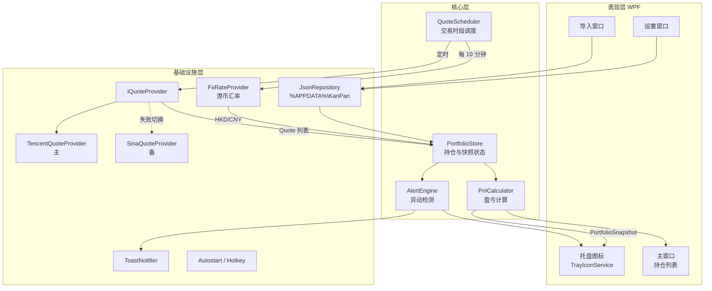

# KanPan 看盘小工具 — 技术方案

版本：v0.1（草案）　日期：2026-10-21　对应 PRD：[PRD.md](./PRD.md)

## 1. 技术选型

### 1.1 方案对比

| 方案 | 安装包体积 | 常驻内存 | 托盘 / 通知 / 置顶窗 | 开发效率 | 结论 |
| --- | --- | --- | --- | --- | --- |
| **C# .NET 10 + WPF** | 约 78MB（自包含单文件，已压缩） | 40–60MB | 原生支持，最完善 | 高 | **推荐** |
| Python + PySide6 | 约 40–60MB（PyInstaller） | 60–100MB | 支持，Toast 需额外库 | 很高 | 备选 |
| Tauri (Rust + Web) | 约 5–10MB | 30–60MB | 支持，悬浮窗细节需调 | 中 | 备选 |
| Electron | 约 150MB | 150MB+ | 支持 | 高 | 太重，不选 |

**选择 .NET + WPF 的理由**：只在 Windows 上用，需要的托盘图标、Toast 通知、全局热键、开机自启，在 .NET 里都是原生 API 或成熟库，坑最少；内存占用低；可以发布成单个 exe。

**版本用 .NET 10 而不是 .NET 8**：.NET 8 的官方支持在 2026 年 11 月结束，.NET 10 是当前的长期支持（LTS）版本，支持到 2028 年 11 月。

### 1.2 依赖清单

| 用途 | 库 |
| --- | --- |
| UI | WPF (.NET 10, `net10.0-windows10.0.17763.0`) |
| MVVM | CommunityToolkit.Mvvm |
| 托盘图标 | WinForms `NotifyIcon`（不额外引入第三方库） |
| Toast 通知 | Microsoft.Toolkit.Uwp.Notifications（支持非打包应用）；不可用时退回托盘气泡 |
| Excel 导入（v0.2） | MiniExcel（轻量，只读即可） |
| JSON | System.Text.Json |
| GBK 解码 | `CodePagesEncodingProvider`（.NET 自带） |
| 日志 | 自写的按天滚动文件日志（约 50 行，避免引入依赖） |
| 测试 | xUnit |

## 2. 总体架构



数据流向只有一个方向：**调度器定时拉行情 → 更新 Store → 计算出快照 → 推送给各个 UI 和异动检测**。UI 只读取快照，不直接调行情接口。

## 3. 行情数据源

### 3.1 腾讯行情（主数据源）

```
GET https://qt.gtimg.cn/q=sh600519,sz000001,bj830799
```

- 一次请求可以查多只股票（建议每批不超过 60 只），返回 **GBK** 编码的文本。
- 返回格式：`v_sh600519="1~贵州茅台~600519~1688.00~1675.00~1676.00~...";`，按 `~` 切分后取：

| 下标 | 字段 |
| --- | --- |
| 1 | 名称 |
| 2 | 代码 |
| 3 | 现价 |
| 4 | 昨收 |
| 5 | 今开 |
| 30 | 行情时间 `yyyyMMddHHmmss` |
| 31 | 涨跌额 |
| 32 | 涨跌幅 (%) |

- 无效代码会返回 `v_pv_none_match="1";`，导入校验时据此判断代码不存在。
- **港股**：用 `r_hk00700`（`r_` 前缀表示实时行情；不带前缀的 `hk00700` 是延时 15 分钟的行情）。名称、现价、昨收的下标和 A 股一样，但行情时间字段的格式是 `yyyy/MM/dd HH:mm:ss`，需要单独解析。价格固定补到 3 位小数（`382.400`），解析时去掉多余的 0。
- **ETF**：价格有 3 位小数，解析和显示时不能截成 2 位。

### 3.2 新浪行情（备用数据源）

```
GET https://hq.sinajs.cn/list=sh600519,sz000001,rt_hk00700
Header: Referer: https://finance.sina.com.cn
```

- 必须带 Referer，否则返回 403；同样是 GBK 编码。
- A 股字段：`名称,今开,昨收,现价,最高,最低,...,日期(30),时间(31)`。
- 港股用 `rt_hk` 前缀拿实时行情，字段顺序和 A 股**不一样**：0 英文名、1 中文名、2 今开、3 昨收、6 现价、17 日期 `yyyy/MM/dd`、18 时间。无效代码同样返回空字符串。

### 3.3 港币汇率

- 主：腾讯 `GET https://qt.gtimg.cn/q=whHKDCNY`，下标 3 是汇率。
- 备：新浪 `GET https://hq.sinajs.cn/list=fx_shkdcny`（要带 Referer），下标 8 是最新汇率，保留 4 位小数。
- 只在持有港股时获取：启动时一次，之后港股非收盘时段每 10 分钟一次；成功后缓存到 `settings.json` 的 `hkdCnyRate`，下次启动先用缓存值。
- 获取失败时继续用上次的汇率，1 分钟后重试，不影响行情的「数据过期」标记。从没拿到过汇率时，港股不计入合计。
- 汇率只影响港股折算成人民币后的金额，不影响港股自身的涨跌幅和异动提醒。

> 以上字段下标已用 2026-10-22 收盘后的真实返回确认，测试数据在 `tests/KanPan.Tests/Fixtures/*_hk.txt`、`*_fx.txt`。

### 3.4 抽象接口

```csharp
public interface IQuoteProvider
{
    string Name { get; }
    Task<IReadOnlyList<Quote>> GetQuotesAsync(IReadOnlyList<SecurityId> ids, CancellationToken ct);
}

public sealed record Quote(
    SecurityId Id,
    string Name,
    decimal Price,
    decimal PrevClose,
    DateTime QuoteTime);
```

- **涨跌幅自己算**：`(Price − PrevClose) / PrevClose`，不直接用接口返回的值，这样两个数据源口径一致。
- **停牌 / 未开盘**：现价为 0 时，用昨收代替现价，并标记为停牌。
- **故障切换**：`FailoverQuoteProvider` 包装主、备两个数据源。主源连续失败 3 次切到备源；之后每 5 分钟试探一次主源，恢复了就切回来。
- **请求参数**：HttpClient 全局单例，超时 3 秒，带浏览器 User-Agent。

> 风险：这两个都是非官方公开接口，可能改格式或限流。所以接口做成可插拔，解析逻辑单独写单元测试，用录制好的真实返回文本做测试数据。

## 4. 核心模块设计

### 4.1 领域模型

```csharp
public enum Market { SH, SZ, BJ, HK }
public enum Currency { CNY, HKD }

public readonly record struct SecurityId(Market Market, string Code)
{
    // "600519" -> SH, "sz000001" -> SZ, "700" -> HK 00700
    public static SecurityId Parse(string raw);
    public Currency Currency => Market == Market.HK ? Currency.HKD : Currency.CNY;
    public string ToTencentSymbol();   // sh600519 / r_hk00700
    public string ToSinaSymbol();      // sh600519 / rt_hk00700
}

public sealed record Holding(SecurityId Id, long Shares, decimal? CostPrice);

// 原币金额用于明细展示，Cny 结尾的字段用于汇总
public sealed record HoldingView(
    Holding Holding, Quote? Quote,
    decimal MarketValue, decimal DayPnl, decimal DayPct,
    decimal MarketValueCny, decimal DayPnlCny,
    decimal? TotalPnl, decimal? TotalPct, bool IsStale);

public sealed record PortfolioSnapshot(
    IReadOnlyList<HoldingView> Items,
    decimal TotalMarketValueCny,
    decimal DayPnlCny, decimal DayPct,
    decimal? TotalPnlCny, decimal? TotalPct,
    decimal HkdCnyRate, bool IsRateStale,
    IReadOnlyDictionary<Market, MarketPhase> Phases,
    DateTime UpdatedAt, bool IsStale);
```

金额全部用 `decimal`，避免浮点误差。

> 实际实现做了简化：没有 `Currency` 枚举，`SecurityId` 提供 `IsHongKong`、`Group`（`MarketGroup.AShare` / `HongKong`，同组共用交易时段）和 `CurrencyUnit`。`HoldingView` 的金额字段直接存人民币，另带 `FxRate`（A 股为 1，港股为汇率，缺汇率时为 null）；`PortfolioSnapshot` 只有一个合并后的 `Phase`（取各市场里最活跃的阶段）和 `HkdCnyRate`。

### 4.2 代码识别 `SecurityId.Parse`

按顺序匹配：
1. 带前缀的（`sh` / `sz` / `bj` / `hk`，不区分大小写）直接解析；也兼容 `00700.HK`、`600519.SH` 这种后缀写法。
2. 6 位纯数字，按开头判断：
   - `60`、`68`、`5`、`900` → SH
   - `00`、`30`、`1`、`200` → SZ
   - `8`、`4`、`92` → BJ
3. 1–5 位纯数字 → HK，左边补零到 5 位（`700` → `00700`）。
4. 都不匹配 → 报错，在导入界面标红该行。

### 4.3 盈亏计算 `PnlCalculator`

纯函数，没有副作用，方便单元测试：

```
单只（原币）：
  市值        = 现价 × 股数
  期初股数    = 当前股数 − 当日买入股数 + 当日卖出股数
  当日盈亏    = 现价 × 当前股数 − 昨收 × 期初股数
                + 当日卖出金额 − 当日买入金额 − 当日手续费
  持仓盈亏    = (现价 − 成本价) × 股数          （只算填了成本价的）

折算人民币：
  汇率 r      = 1（A 股 / ETF）或 HKD/CNY（港股）
  人民币金额  = 原币金额 × r

汇总（全部用人民币）：
  当日比例    = Σ当日盈亏 / Σ(昨收 × 期初股数 × r)
  持仓比例    = Σ持仓盈亏 / Σ(成本价 × 股数 × r)
```

注意：
- `portfolio.json` 同时保存最近一个有交易日的成交记录；按行情交易日匹配计算，已清仓的证券仍获取行情以保留当天收益并识别跨日。没有当天成交记录时按无交易持仓计算。
- 账户汇总包含清仓收益，可能大于当前持仓行的合计。比例基数不含现金，期初无持仓时为 0%；未登记的交易、费用和分红不会自动同步。
- 「当日」指行情里最新的那个交易日。周末、节假日或开盘前，显示的是上一交易日的盈亏，界面标签会写成「10-16 盈亏」而不是「当日盈亏」。行情日期比这个交易日更早的股票（比如长期停牌），当日盈亏按 0 计。
- 当日盈亏比例的分母要用**昨日总市值**，不能用今日市值，否则比例会偏小。
- 汇总时，昨日市值、今日市值和当日成交用同一个汇率。这样汇率波动不会算进当日盈亏，盈亏反映持仓变化及成交价格、费用。
- 某个市场当天休市时，这个市场的持仓当日盈亏为 0，但市值仍然计入分母。

### 4.4 交易时段调度 `QuoteScheduler`

`MarketCalendar` 按市场分别给出当前所处阶段，A 股和港股各有一份时间表：

| 阶段 | A 股（SH/SZ/BJ） | 港股（HK） | 刷新间隔 | 检测异动 |
| --- | --- | --- | --- | --- |
| PreOpen 开盘前竞价 | 09:15–09:30 | 09:00–09:30 | 用户设置（默认 5 秒） | 否 |
| Trading 连续交易 | 09:30–11:30、13:00–15:00 | 09:30–12:00、13:00–16:00 | 用户设置 | 是 |
| Lunch 午休 | 11:30–13:00 | 12:00–13:00 | 60 秒 | 否 |
| ClosingAuction 收市竞价 | — | 16:00–16:10 | 用户设置 | 否 |
| Closed 已收盘 | 15:00 之后 | 16:10 之后 | 不轮询 | 否 |

调度规则：
- 每一轮只请求**当前不是 Closed 的市场**的持仓；各市场按自己的刷新间隔，取所有市场中最短的那个作为下一轮的等待时间。
- 每个市场从非 Closed 进入 Closed 时，再补拉一次，拿到最终收盘价。程序启动时，所有市场都先拉一次。
- 用 `PeriodicTimer` 加后台 Task 实现，每轮请求带 `CancellationToken`，**上一轮没结束就跳过本轮**，避免请求堆积。
- **节假日判断**：按市场分别判断，开盘 10 分钟后（A 股 09:40）才开始判断，避免刚开盘时行情还没刷新造成误判。某个市场在交易时段内拿到的行情时间日期都不是今天，就认为这个市场今天休市，当天剩余时间都按 Closed 处理。两地节假日不同，这样不需要维护节假日表。
- 监听系统休眠 / 唤醒（`SystemEvents.PowerModeChanged`），唤醒后立刻刷新一次。
- 时间统一按北京时间（`China Standard Time`）计算，不依赖电脑本地时区。

### 4.5 异动提醒 `AlertEngine`

**状态**：每只股票记录今天已经提醒过的最高档位（涨、跌分开记）。

```csharp
sealed class AlertState
{
    public DateOnly TradeDate;
    public Dictionary<SecurityId, (int UpLevel, int DownLevel)> Levels;
}
```

**判断逻辑**（每次拿到新行情后执行）：

```
档位 = [5%, 7%, 9.5%]（可配置）
对每只股票：
    pct = 当日涨跌幅
    level = pct 已越过的最高档位序号（0 表示未越过）
    if pct > 0 且 level > state.UpLevel:
        发出「大涨」提醒；state.UpLevel = level
    if pct < 0 且 level > state.DownLevel:
        发出「大跌」提醒；state.DownLevel = level
```

- 交易日变化时清空状态。
- 状态保存到磁盘，**当天重启程序不会重复提醒**。
- **启动时汇总**：程序启动后第一轮发现多只股票已超过阈值时，合并成一条通知（例如「3 只持仓涨跌超过 5%」），不逐条弹出。
- 同一轮里触发超过 3 条提醒时，也合并成一条。
- 「回落后重新提醒」选项开启时：涨跌幅回落到 `阈值 − 1%` 以下，就把该方向档位重置为 0（留 1% 缓冲，避免在阈值附近来回抖动时反复提醒）。

**输出**：`AlertRaised` 事件 → `ToastNotifier` 弹系统通知，`TrayIconService` 让图标闪烁，主窗口对应行高亮。

### 4.6 托盘图标 `TrayIconService`

- 用 `System.Drawing` 按系统小图标尺寸（随 DPI 为 16/20/24/32 像素）画位图：圆角底色红 / 绿 / 灰，中间写当日盈亏百分比的绝对值，涨跌方向靠颜色表示：
  - 小于 10%：保留一位小数，例如 `1.2`。用截断而不是四舍五入，避免 4.99% 显示成 `5.0`。
  - 10% 及以上：显示整数，例如 `12`；最多显示 `99`。
  - 灰色表示没有数据或网络异常；黄色 `!` 是有异动提醒时的闪烁图标。
- 位图转 `Icon` 时，`GetHicon()` 拿到的句柄要调用 `DestroyIcon` 释放，否则每次刷新都会泄漏 GDI 句柄。
- **只有显示内容变化时才重画图标**，节省资源。
- 悬停提示（Tooltip）最多 127 个字符，只放时间、当日盈亏、总市值。
- 闪烁：用 500ms 定时器在正常图标和高亮图标之间切换，用户打开主窗口后停止。

### 4.7 系统集成

| 功能 | 实现方式 |
| --- | --- |
| 开机自启 | 写注册表 `HKCU\Software\Microsoft\Windows\CurrentVersion\Run`（不需要管理员权限） |
| 老板键 | Win32 `RegisterHotKey`；热键被占用时在设置界面提示冲突 |
| 只允许运行一个实例 | 命名 `Mutex`；第二次启动时通过命名管道通知已运行的实例显示主窗口，然后退出 |
| Toast 通知 | `ToastContentBuilder`；点击通知打开主窗口并定位到该股票 |

## 5. 数据存储

存放目录：`%APPDATA%\KanPan\`

| 文件 | 内容 |
| --- | --- |
| `portfolio.json` | 持仓列表 |
| `settings.json` | 用户设置 |
| `alert-state.json` | 当日已提醒档位 |
| `logs\kanpan-*.log` | 滚动日志，保留 7 天 |

```json
// portfolio.json
{
  "version": 1,
  "holdings": [
    { "symbol": "sh600519", "shares": 100, "costPrice": 1550.00 },
    { "symbol": "sz000001", "shares": 2000, "costPrice": null },
    { "symbol": "sh510300", "shares": 10000, "costPrice": 3.852 },
    { "symbol": "hk00700", "shares": 200, "costPrice": 380.00 }
  ]
}
```

```json
// settings.json
{
  "version": 1,
  "refreshSeconds": 5,
  "alertLevels": [5.0, 7.0, 9.5],
  "realertOnRetreat": false,
  "colorScheme": "RedUp",
  "autoStart": true,
  "bossKey": "Ctrl+Alt+K",
  "privacyMode": false,
  "hkdCny": { "manualRate": null, "lastRate": 0.9135, "lastUpdated": "2026-10-21T14:30:00+08:00" }
}
```

- **写文件要安全**：先写到 `*.tmp`，再用 `File.Replace` 替换原文件，防止写到一半断电导致文件损坏。
- 每个文件都带 `version` 字段，以后改格式时用来做数据迁移。

## 6. 导入解析

- **文本**：按行切分，每行用正则 `[,\s\t，]+` 分隔（兼容中文逗号），忽略空行和 `#` 开头的注释行；第一行如果是表头（含「代码」或 code）就跳过。
- **CSV**：自动识别 UTF-8 / GBK 编码（Excel 另存的 CSV 经常是 GBK）。
- **Excel**：MiniExcel 读第一个工作表，按表头名称匹配列（代码 / 证券代码 / code，股数 / 数量 / shares，成本 / 成本价 / cost）。代码列要按文本读取，否则 Excel 会把 `000001`、`00700` 前面的 0 去掉；如果读到的是数字，就按位数规则补回前导 0。
- 解析结果显示在预览表格里，每行带状态：✓ 正常 / ⚠ 重复已合并 / ✗ 错误原因。用户确认后才保存。
- 导入模式：**覆盖**（默认）或**合并**到现有持仓。

## 7. 工程结构

```
KanPan/
├─ docs/
│  ├─ PRD.md
│  └─ TECH_DESIGN.md
├─ src/
│  ├─ KanPan.Core/              # 纯逻辑，不依赖 UI，可单元测试
│  │  ├─ Models/                # SecurityId, Holding, Quote, Snapshot
│  │  ├─ Pnl/PnlCalculator.cs
│  │  ├─ Alerts/AlertEngine.cs
│  │  ├─ Schedule/MarketCalendar.cs   # 判断当前交易阶段
│  │  └─ Import/HoldingParser.cs
│  ├─ KanPan.Infrastructure/
│  │  ├─ Quotes/TencentQuoteProvider.cs
│  │  ├─ Quotes/SinaQuoteProvider.cs
│  │  ├─ Quotes/FailoverQuoteProvider.cs
│  │  ├─ Fx/FxRateProvider.cs
│  │  ├─ Storage/JsonRepository.cs
│  │  └─ System/AutoStart.cs, HotKey.cs, SingleInstance.cs
│  └─ KanPan.App/               # WPF 程序入口
│     ├─ App.xaml
│     ├─ Services/TrayIconService.cs, ToastNotifier.cs, QuoteScheduler.cs
│     ├─ Views/MainWindow, ImportWindow, SettingsWindow
│     └─ ViewModels/
└─ tests/
   └─ KanPan.Tests/             # 代码识别、盈亏计算、异动档位、时段判断、行情解析、存储
      └─ Fixtures/              # 真实接口返回的录制数据
```

## 8. 异常处理

| 场景 | 处理 |
| --- | --- |
| 网络断开 / 超时 | 保留上次数据，界面标记「数据过期」并显示最后更新时间；托盘图标变灰；按 5s → 10s → 30s → 60s 逐步拉长重试间隔 |
| 主数据源返回格式变了 | 解析失败的股票记日志，切到备用数据源 |
| 个别代码无效 | 该行显示「无行情」，不计入合计，不影响其他股票 |
| 汇率获取失败 | 用缓存的汇率，再不行用手动设置的汇率；界面标注「汇率非实时」。三者都没有时，港股不计入合计，并提示用户设置汇率 |
| 配置文件损坏 | 把坏文件备份为 `*.bak`，加载默认配置，提示用户 |
| 未处理异常 | 全局捕获 `DispatcherUnhandledException` 和 `TaskScheduler.UnobservedTaskException`，写日志，不让程序崩溃退出 |

## 9. 打包发布

```powershell
dotnet publish src/KanPan.App -c Release -r win-x64 `
  --self-contained true -p:PublishSingleFile=true `
  -p:IncludeNativeLibrariesForSelfExtract=true
```

- 再加上 `-p:EnableCompressionInSingleFile=true -p:DebugType=none`，输出一个单独的 `KanPan.exe`（约 78MB，不压缩约 188MB），绿色免安装，双击运行。
- 如果电脑上已经装了 .NET 10 Desktop Runtime，可以用 `--self-contained false` 打包，体积只有几 MB。
- 后续如果需要安装包，可以用 Inno Setup 制作，或者用 Velopack 支持自动更新。

## 10. 测试计划

- **单元测试**（重点）：
  - 代码识别：各种代码开头、带前缀和后缀、港股补零、Excel 丢失前导 0、非法输入
  - 盈亏计算：停牌、成本价缺失、比例分母、港币折算、某个市场休市
  - 异动档位：首次越过、在档位间来回波动、跨交易日重置、回落后重新提醒的缓冲
  - 交易时段：A 股和港股各自的时间边界、午休、收市竞价、周末、只有一地休市
  - 行情解析：用录制的真实返回文本测试，包括 A 股、ETF（3 位小数）、港股、汇率、无效代码、停牌
- **手工测试**：高 DPI / 多显示器、休眠唤醒、断网恢复、热键冲突、Win10 和 Win11 上的 Toast 通知。
- **模拟行情**：做一个 `FakeQuoteProvider`，可以注入任意涨跌幅，收盘后也能演示提醒效果。

## 11. 开发排期（参考）

| 阶段 | 内容 | 预估 |
| --- | --- | --- |
| M1 | Core 层：模型、代码识别、盈亏计算、异动引擎、时段判断 + 单元测试 | 2 天 |
| M2 | 行情：腾讯 / 新浪的 A 股和 ETF 数据源、故障切换、调度器 | 1.5 天 |
| M3 | UI：托盘图标、主窗口、导入窗口、Toast 通知 → **v0.1 MVP 完成** | 2.5 天 |
| M4 | 港股行情、汇率、分市场交易时段（已完成）、设置界面、Excel 导入 → v0.2 | 2.5 天 |
| M5 | 老板键、隐私模式、打包发布 → v0.3 | 1.5 天 |
